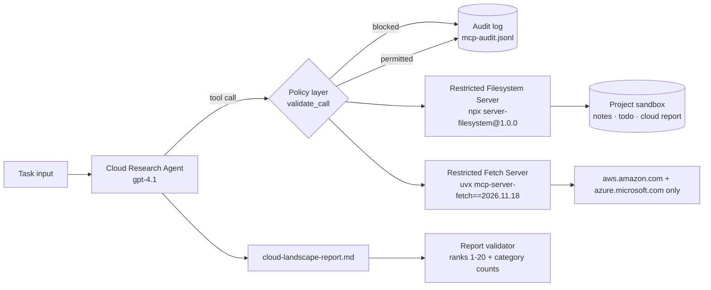

# ☁️ Hardened MCP Research Agent — AWS vs Azure Radar

> An AI research agent that reads private cloud-migration notes **and** the live the AWS blog feed and Azure blog page to compare where each provider is investing — while every tool call is allow-listed, audited, and pinned to a verified package.


## What it does

The agent is given a fictional project ("Project Nimbus": choose AWS or Azure as the primary cloud), reads its local notes and TODO list through a **Filesystem MCP server**, pulls the latest 10 posts from the **AWS News Blog** RSS feed and the **Azure Blog** page through a **Fetch MCP server**, groups all 20 by service category (AI/ML, Compute, Data, Security…), and writes a `cloud-landscape-report.md`. The interesting part is the security wrapper around both servers, which maps to the OWASP MCP Top 10:

| Control | Risk | What this repo does |
|---|---|---|
| Supply-chain pinning | MCP04 | Exact package versions, explicit registries, **npm `sha512` integrity** and **PyPI `sha256`** checks recorded in code |
| Environment allow-list | MCP01 | Child processes only receive approved variables (Windows + macOS/Linux). `OPENAI_API_KEY` is never passed |
| URL & argument policy | MCP06 | Fetch is limited to two exact HTTPS URLs (AWS feed, Azure blog page), bounded `max_length` (≤ 10,000) / `start_index`, no extra arguments; private IPs and foreign redirects blocked |
| Path & tool policy | — | Filesystem exposes 4 tools; reads limited to 3 files, writes limited to one report path |
| Audit logging | MCP08 | JSONL record per call (`requested → permitted → succeeded/blocked`), **never** logging arguments or content |

## Architecture



## Tech stack

- **Language:** Python 3.11+ (notebook-style script with top-level `await`)
- **Agent framework:** OpenAI Agents SDK (`agents`) with tracing
- **Protocol:** Model Context Protocol (`mcp`), stdio transport
- **MCP servers:** `@modelcontextprotocol/server-filesystem` (Node/npx), `mcp-server-fetch` (uv/uvx)
- **Tooling:** python-dotenv, IPython display, Node.js ≥ 18, uv

## Project structure

```
hardened-mcp-research-agent/
├── src/
│   └── hardened_mcp_agent.py   # Steps 1–8: setup, policy, audit, agent run, validation
├── docs/
│   └── PLAN.md                 # Roadmap and design decisions
├── requirements.txt
├── .env.example
└── LICENSE
```

Runtime folders (`cloud_project_nimbus/` sandbox, `cloud_project_decoy/` decoy, `security-audit/`) are generated on first run and git-ignored.

## Walkthrough of the script

1. **Imports & env** – verifies `OPENAI_API_KEY`, Node and npx.
2. **Sandbox** – creates the project folder, sample notes, and a decoy folder the agent must not reach.
3. **Audit logging** – `write_audit_event` / `audited_tool_call`.
4. **MCP config** – pinned Filesystem server, environment allow-list, `RestrictedFilesystemServer`.
5. **Package checks** – asserts args, registry metadata, npm integrity, and PyPI hashes.
6. **Policy tests** – offline proofs that secrets, outside paths, bad URLs and SSRF targets are blocked.
7. **Agent run** – `source_digest()` first parses the AWS feed and Azure page in code (title/link/category only, ~4.6 KB instead of ~100 KB of raw HTML/XML) and hands that digest to the agent, which fetches a page directly only to confirm a single item. Turn limit is 15 on the first run and 8 on repairs; rate-limit retries are capped at 3. If the report is not saved and grounded, there are at most `MAX_REPAIR_ATTEMPTS = 2` repairs, each starting from a fresh short input (task + digest + problem list), never the full history. Still ungrounded after the cap: it raises a `RuntimeError` listing the problems and makes no further model calls.
8. **Report validation** – ranks 1–20 in order (10 AWS, then 10 Azure); category counts reconcile with the table.

## Getting started

```bash
git clone https://github.com/emran-Automation-Techlead/hardened-mcp-research-agent
cd hardened-mcp-research-agent
pip install -r requirements.txt
cp .env.example .env        # add your OPENAI_API_KEY
```

Install [Node.js](https://nodejs.org) and [uv](https://docs.astral.sh/uv/), then open `src/hardened_mcp_agent.py` in VS Code/Jupyter and run the cells in order. Confirm the Fetch flags on your machine first:

```bash
uvx --from mcp-server-fetch==2026.11.18 mcp-server-fetch --help   # expect --allowed-hosts, --no-readability-js
```

## Upgrading a pinned package

Hashes are recorded constants. After reviewing a new release, re-run `npm view <pkg>@<ver> dist.integrity` and the PyPI JSON endpoint, then update `EXPECTED_*` together with the version.

## Limitations

Pinning and hash checks reduce, but do not eliminate, supply-chain risk and say nothing about vulnerabilities in the package. A single feed snapshot shows what was published recently, not long-term investment, pricing or product quality.

## Documentation & evidence

- 📄 [Full guide (PDF)](docs/Hardened-MCP-Agent-Guide.pdf): how it works, how to use it, how traces are verified, live results
- 🧪 [Run history](docs/run-history/): the real agent outputs from each run, including the ones that failed verification
- 🗺️ [Plan & roadmap](docs/PLAN.md)

**Lesson from the live runs:** one run passed the rank/count validator while containing invented rows. The grounding check in Step 6d re-reads the AWS feed and Azure blog page and compares every row, so a well-formatted but fabricated report cannot pass.
